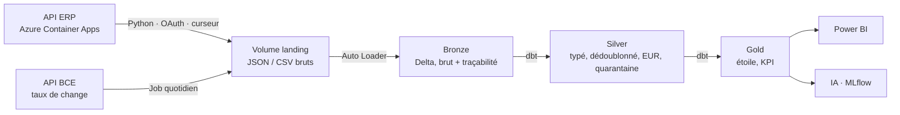

# AgriMeca Supply Chain — Data Engineering sur Azure Databricks

Pipeline de données de bout en bout pour piloter la performance fournisseurs d'un industriel fictif, AgriMeca : ingestion d'une **API ERP** (OAuth, pagination, quotas, pannes), architecture **médaillon** sur **Azure Databricks / Unity Catalog**, transformations et tests **dbt**, restitution **Power BI** et cas d'usage **IA**.

> Projet personnel de portfolio. L'ERP est simulé, mais ses contraintes sont celles d'une vraie API d'entreprise, et les volumes sont réalistes : **1,3 million de commandes, 5,2 millions de lignes**.

---

## Problème métier

Les acheteurs veulent savoir quels fournisseurs livrent **à l'heure et en totalité** (OTIF), quels articles concentrent les achats (**ABC**), quels sont les **délais réels** de livraison, et quelles commandes ouvertes risquent d'arriver **en retard**.

Les données existent dans l'ERP, mais elles sont exposées par une API et sont « sales » : trois formats de date, devises manquantes, unités hétérogènes, quantités négatives ou multipliées par 1 000, doublons, suppressions logiques. Les montants sont en 7 devises.

## Architecture



| Couche | Emplacement | Outil | Rôle |
| --- | --- | --- | --- |
| Dépôt brut | `supplychain.landing` (Volumes) | Python | réponses d'API conservées telles quelles |
| Bronze | `supplychain.bronze` | Auto Loader | une ligne par enregistrement, JSON brut et colonnes de traçabilité |
| Silver | `supplychain.silver` | dbt | typage, dédoublonnage, règles de gestion, contrôle qualité |
| Gold | `supplychain.gold` | dbt | modèle en étoile et indicateurs |

## Ce que le projet démontre

- **Ingestion robuste d'une API contrainte** : jeton qui expire, quotas (`429`), pannes (`5xx`), coupures réseau ; nouveaux essais automatiques et **reprise d'un run interrompu** au dernier curseur, sans doublon.
- **Traitement incrémental** : Auto Loader ne lit que les nouveaux fichiers ; une relance n'ajoute aucune ligne (idempotence vérifiée).
- **Qualité des données mesurée** : une trentaine de tests dbt et une quarantaine qui a révélé que **0,5 % des lignes faussaient 84 % des montants**.
- **Maîtrise des coûts (FinOps)** : chargement historique en local, calcul cloud réservé aux traitements, consommation mesurée par notebook et par Job.
- **Orchestration** : Job Databricks quotidien, avec nouveaux essais et alerte en cas d'échec.
- **Sécurité** : aucun secret dans le code ni dans Git (Key Vault, secret scope, OAuth).

## Chiffres clés

| Mesure | Valeur |
| --- | --- |
| Données chargées en Bronze | 1 290 380 commandes, 399 958 articles, 43 200 lectures de fournisseurs |
| Lignes de commande en Silver | 5 163 695, sans doublon |
| Chargement Bronze des commandes (Databricks serverless) | 2 964 fichiers en 56 s |
| Reprise d'ingestion après interruption | 418 380 commandes en ~1 h 30, au lieu de 5 à 6 h depuis le début |
| Lignes valides après contrôle qualité | 99,0 % |
| Taux de change | 7 devises × 1 137 jours, mis à jour chaque jour ouvré |

## Le pipeline en bref

**Ingestion** — Un module Python (`src/erp_ingest`) lit l'API page par page et dépose chaque réponse brute dans un dossier `ingest_date=…/run_id=…`. Le même code tourne en local et dans Databricks. L'historique a été chargé en local puis copié vers le Volume, pour ne pas payer de calcul cloud pendant l'attente de l'API. Un script séparé récupère les taux de référence de la BCE.

**Bronze** — Auto Loader lit les nouveaux fichiers, une ligne par enregistrement, avec un schéma déclaré (aucune inférence) et quatre colonnes de traçabilité. Le Bronze conserve tout, doublons compris : rien n'est perdu, tout peut être retraité.

**Silver** — dbt transforme le JSON en 7 tables relationnelles typées, testées et documentées : 5 modèles de staging, fidèles à la source, et 2 modèles intermédiaires qui appliquent les règles de gestion.

**Gold** *(prochaine étape)* — modèle en étoile (`dim_supplier`, `dim_part`, `dim_date`, `fact_po_line`) et indicateurs : OTIF, retards, dépenses par catégorie, ABC.

## Règles de gestion du Silver

| Règle | Pourquoi |
| --- | --- |
| Un enregistrement = une ligne, dans sa version la plus récente | l'ERP renvoie un même enregistrement à chaque modification |
| Dates normalisées, quel que soit le format reçu (3 formats) | une date illisible fausserait les délais |
| Les lignes de commande imbriquées deviennent une table | les délais et les quantités se calculent ligne par ligne |
| Un taux de change pour chaque jour, week-ends compris (dernier taux publié) | une commande du samedi doit pouvoir être convertie |
| Devise manquante remplacée par celle du fournisseur, avec une trace | 2 % des lignes n'ont pas de devise |
| Boîtes de 12 converties en pièces | additionner des volumes comparables |
| Montant converti en EUR au taux du jour de commande | comparer des achats en 7 devises |
| Lignes aberrantes mises en **quarantaine**, jamais supprimées | elles représentaient 84 % des montants pour 0,5 % des lignes |

Limite connue : les prix du simulateur ne tiennent pas compte de la devise, ce qui sous-pondère les fournisseurs hors zone euro. Elle est documentée plutôt que corrigée, pour ne pas inventer de données.

## Démarrer

```bash
git clone https://github.com/Randriatahina-concept/agrimeca-supplychain-de.git
cd agrimeca-supplychain-de
python3 -m venv .venv && source .venv/bin/activate
pip install -e ".[dev]" dbt-databricks

python scripts/ingest_local.py suppliers      # ingestion (secrets lus dans Key Vault)
cd dbt/agrimeca && dbt build                  # Silver : modèles et tests
```

Les configurations Azure, Databricks et dbt sont détaillées pas à pas dans la documentation technique.

## Structure du dépôt

```text
agrimeca-supplychain-de/
├── src/erp_ingest/     # module d'ingestion de l'API ERP
├── scripts/            # lancements locaux : ingestion, taux BCE, Bronze local, exploration DuckDB
├── Notebook/           # notebooks Databricks : ingestion, Bronze Auto Loader, taux BCE
├── dbt/agrimeca/       # projet dbt : staging, intermediate, macros, tests
├── tests/              # tests pytest
└── pyproject.toml
```

## Feuille de route

| Étape | Statut |
| --- | --- |
| API ERP simulée sur Azure, ingestion robuste avec reprise | fait |
| Bronze Auto Loader, contrôles de complétude et d'idempotence | fait |
| Taux de change BCE, Job quotidien | fait |
| Silver dbt : staging, règles de gestion, quarantaine, tests | fait |
| Historisation SCD2 (noms de fournisseurs, prix) | à venir |
| Gold : modèle en étoile, OTIF, délais, ABC | prochaine étape |
| Ingestion incrémentale et orchestration complète | à venir |
| CI GitHub Actions (`ruff`, `pytest`, `dbt parse`) | à venir |
| Power BI et modèle IA de risque de retard | à venir |

## Documentation

- **Dossier technique** : toutes les configurations, le code commenté, les résultats de chaque étape, la démarche FinOps et le dépannage.
- **Dictionnaire des données** : chaque table et chaque colonne, les valeurs possibles et les défauts connus.

## Stack

Azure Container Apps · Azure Key Vault · Azure Databricks (Unity Catalog, Volumes, Auto Loader, SQL Warehouse, Jobs) · Python · PySpark · dbt · DuckDB · Power BI · GitHub

## Auteur

Charles Randriatahina, Data Engineer
