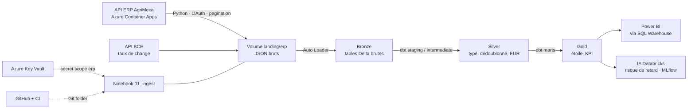

# AgriMeca Supply Chain — Data Engineering sur Azure Databricks

Projet de data engineering de bout en bout : ingestion d'une **API ERP** (OAuth, pagination, quotas, erreurs), architecture **médaillon** sur **Azure Databricks / Unity Catalog**, transformations **dbt**, restitution **Power BI** et un cas d'usage **IA**, pour piloter la performance fournisseurs d'un industriel fictif, AgriMeca.

> Projet personnel d'apprentissage et de portfolio. L'ERP est simulé, mais ses contraintes sont celles d'une vraie API d'entreprise.

---

## Sommaire

1. [Problème métier](#problème-métier)
2. [Architecture](#architecture)
3. [L'API ERP simulée](#lapi-erp-simulée)
4. [Configurations réalisées](#configurations-réalisées)
5. [Ingestion API vers le Volume](#ingestion-api-vers-le-volume)
6. [Exécution locale et exécution Databricks](#exécution-locale-et-exécution-databricks)
7. [Volumétrie traitée et performances](#volumétrie-traitée-et-performances)
8. [Silver avec dbt : règles de gestion](#silver-avec-dbt--règles-de-gestion)
9. [Feuille de route](#feuille-de-route)
10. [Structure du dépôt](#structure-du-dépôt)
11. [Sécurité, qualité et coûts](#sécurité-qualité-et-coûts)
12. [Dépannage](#dépannage)

---

## Problème métier

Les acheteurs d'AgriMeca ne savent pas répondre rapidement à des questions comme :

- Quels fournisseurs livrent **à l'heure et en totalité** (OTIF) ?
- Quels articles concentrent l'essentiel des achats (**analyse ABC**) et dépendent de fournisseurs à risque ?
- Quels sont les **délais réels** de livraison (médiane, P90) par fournisseur ?
- Quelles commandes ouvertes risquent d'arriver **en retard** ?

Les données existent dans l'ERP, mais elles sont exposées par une API et sont « sales » : trois formats de date, devises manquantes, unités hétérogènes (`BOX12`, `KG`), quantités négatives ou multipliées par 1000, doublons de fournisseurs, suppressions logiques.

## Architecture



| Couche | Emplacement Unity Catalog | Outil | Règle |
| --- | --- | --- | --- |
| Dépôt brut | `supplychain.landing.erp` (Volume) | Python (`requests`) | réponse de l'API conservée telle quelle |
| Bronze | `supplychain.bronze.*` | Auto Loader | une ligne par enregistrement, JSON brut + colonnes techniques |
| Silver | `supplychain.silver.*` | dbt | typage, dates, dédoublonnage, conversion EUR, quarantaine |
| Gold | `supplychain.gold.*` | dbt | modèle en étoile, KPI, fiche fournisseur |
| Exploitation | `supplychain.ops.*` | Python / SQL | journal des runs, alertes de volumétrie |

## L'API ERP simulée

API FastAPI déployée sur **Azure Container Apps**, documentée en OpenAPI : `/docs` (Swagger) et `/openapi.json`.

| Route | Rôle |
| --- | --- |
| `POST /auth/token` | jeton OAuth *client credentials*, valable 15 minutes |
| `GET /v1/suppliers` | fournisseurs |
| `GET /v1/parts` | articles |
| `GET /v1/purchase-orders` | commandes d'achat (JSON imbriqué : lignes, fournisseur, site) |

Paramètres de lecture : `limit` (1 000 max), `cursor`, `updated_since`.

Chaque réponse de liste a la même forme :

```json
{
  "data":   [ { "id": "SUP-00001", "name": "…", "audit": { "updated_at": "…" }, "deleted": false } ],
  "paging": { "next_cursor": "eyJ1Ij…", "has_more": true, "limit": 1000 },
  "meta":   { "as_of": "2026-10-31T15:30:00Z", "count": 1000 }
}
```

- **Pagination par curseur** (*keyset*) : le curseur est un JSON encodé en base64 (date de modification, id, `as_of`). On le renvoie tel quel, sans jamais le construire.
- **`meta.as_of`** fige l'instant de lecture et sert de *watermark* pour l'incrémental.
- **Contraintes reproduites volontairement** : 120 appels par minute (`429` + `Retry-After`), environ 5 % d'erreurs `500/503`, jeton expirant, données de qualité variable.

### Volumétrie

La base SQLite est générée dans l'image au déploiement (`ARG SCALE` du `Dockerfile`). Le déploiement actuel utilise `SCALE=10` :

| Fournisseurs | Articles | Commandes | Lignes de commande |
| --- | --- | --- | --- |
| ~21 600 (doublons inclus) | ~400 000 | ~1 500 000 | ~6 000 000 |

### Simulateur d'activité

Pour que l'ingestion incrémentale ait toujours quelque chose à récupérer, l'API embarque un simulateur qui fait « vivre » l'ERP. Au démarrage du conteneur, `start.sh` lance deux processus :

1. `simulate_activity.py`, en tâche de fond, qui modifie la base SQLite à intervalle régulier ;
2. l'API (`uvicorn api:app`), qui expose cette base.

À chaque tick (toutes les `SIMULATE_INTERVAL` secondes, 60 par défaut, avec `SIMULATE_NEW` = 200) :

| Action | Volume par tick | Effet sur les données exposées |
| --- | --- | --- |
| Nouvelles commandes | `SIMULATE_NEW`, chacune avec 1 à 7 lignes | statut `OPEN`, devise manquante dans 2 % des cas |
| Réceptions | jusqu'à `SIMULATE_NEW` commandes ouvertes de 3 à 120 jours | 70 % `RECEIVED`, 30 % `PARTIALLY_RECEIVED` ; date et quantité reçues sur les lignes |
| Annulations | `SIMULATE_NEW / 50` | statut `CANCELLED` |
| Suppressions logiques | `SIMULATE_NEW / 100` | `deleted: true` |
| Fournisseurs renommés | 2 | nom variant (`Tornor SAS` → `TORNOR SAS.`), pour tester l'historisation SCD2 |
| Prix d'articles | `SIMULATE_NEW / 10` | `list_price` + 3 % |

Chaque modification met à jour `audit.updated_at`, ce qui la rend visible par `updated_since`. Avec les réglages par défaut et une API allumée en continu, cela représente environ 12 000 nouvelles commandes par heure.

Deux comportements à connaître :

- **pas d'activité en veille** : avec `--min-replicas 0`, le conteneur s'arrête faute d'appels, et le simulateur avec lui ;
- **état éphémère** : la base vit sur le disque du conteneur. Chaque redémarrage (sortie de veille, nouvelle révision, incident) la ramène à son état de construction ; les commandes créées ou modifiées par le simulateur disparaissent. Le Bronze garde ce qui a déjà été lu, et le Silver retient la version la plus récente de chaque enregistrement.

Réglages :

| Objectif | Commande |
| --- | --- |
| Volume réduit, pour des runs incrémentaux courts | `az containerapp update -n erp-api -g <resource-group> --set-env-vars SIMULATE_NEW=20 SIMULATE_INTERVAL=300` |
| Données figées, sans activité | `az containerapp update -n erp-api -g <resource-group> --set-env-vars SIMULATE_INTERVAL=0` |
| État conservé entre deux redémarrages | monter un partage Azure Files dans la Container App et y placer `erp.db` |

Chaque changement de variable d'environnement crée une nouvelle révision, et réinitialise donc la base.

## Configurations réalisées

### 1. Déploiement de l'API sur Azure Container Apps

```bash
az login
az containerapp up -n erp-api -g <resource-group> --location francecentral \
  --environment <container-apps-env> --source . --ingress external --target-port 8000
```

- `az containerapp up` construit l'image à partir du `Dockerfile`, la pousse dans un Azure Container Registry et crée l'application.
- L'URL publique a la forme `https://<app>.<identifiant-environnement>.<région>.azurecontainerapps.io`. Un domaine personnalisé (CNAME + TXT `asuid`) est possible, avec un certificat HTTPS géré gratuitement.
- Le secret client est stocké comme **secret de la Container App** et exposé à l'API par une variable d'environnement (`CLIENT_SECRET` → `secretref:client-secret`). `CLIENT_ID` garde sa valeur par défaut, `agrimeca-data`.

Démarrer ou arrêter l'API pour maîtriser les coûts :

```bash
az extension add --name containerapp --upgrade
az containerapp start -n erp-api -g <resource-group>
az containerapp update -n erp-api -g <resource-group> --min-replicas 0      # mise en veille hors sessions de travail
```

### 2. Azure Key Vault

Deux secrets, lus par Databricks et par les scripts locaux :

| Secret | Contenu |
| --- | --- |
| `erp-base-url` | URL de l'API, sans `/` final |
| `erp-client-secret` | secret OAuth du client `agrimeca-data` |

```bash
az keyvault secret set --vault-name <key-vault> -n erp-base-url      --value "https://…azurecontainerapps.io"
az keyvault secret set --vault-name <key-vault> -n erp-client-secret --value "…"
```

Le secret existe en deux exemplaires (Key Vault pour les consommateurs, secret de la Container App pour l'API). En cas de rotation, il faut mettre à jour les deux, puis redémarrer la révision de la Container App.

### 3. Secret scope Databricks adossé à Key Vault

Créé depuis `https://<workspace>.azuredatabricks.net/#secrets/createScope` :

- *Scope name* : `erp`
- *DNS name* : `https://<key-vault>.vault.azure.net/`
- *Resource ID* : identifiant de ressource du Key Vault

Ce type de scope exige le modèle d'accès *access policy* et un droit de lecture pour l'application Azure Databricks :

```bash
az keyvault update -n <key-vault> --enable-rbac-authorization false
az keyvault set-policy -n <key-vault> --spn 2ff814a6-3304-4ab8-85cb-cd0e6f879c1d --secret-permissions get list
```

Le scope ne stocke rien : c'est un pont vers Key Vault.

```python
BASE_URL = dbutils.secrets.get("erp", "erp-base-url")          # affiché [REDACTED] dans un notebook
dbutils.secrets.list("erp")                                     # vérification
```

### 4. GitHub relié à Databricks

1. Databricks → *Settings* → **Linked accounts** → *Git integration* : GitHub, via l'application Databricks.
2. GitHub → *Configure* : accès en lecture et écriture **à ce seul dépôt**.
3. *Workspace* → *Users* → dossier personnel → **Create → Git folder** avec l'URL du dépôt.

Synchronisation : *Commit & Push* depuis Databricks, `git pull` sur le poste local, et inversement *Pull* dans Databricks après un `git push` local. Les notebooks sont versionnés au format source `.py`, sans leurs résultats.

### 5. Unity Catalog

Un seul catalogue pour tout le projet :

```sql
CREATE SCHEMA IF NOT EXISTS supplychain.landing;
CREATE SCHEMA IF NOT EXISTS supplychain.bronze;
CREATE VOLUME IF NOT EXISTS supplychain.landing.erp;           -- fichiers JSON déposés par l'ingestion
CREATE VOLUME IF NOT EXISTS supplychain.landing.checkpoints;   -- mémoire d'Auto Loader
```

Les schémas `silver` et `gold` sont créés par dbt. Les volumes sont de type *managed* : Databricks gère le stockage.

### 6. Environnement local

```bash
git clone https://github.com/Randriatahina-concept/agrimeca-supplychain-de.git
cd agrimeca-supplychain-de
python3 -m venv .venv && source .venv/bin/activate
pip install -e ".[dev]"            # installe le projet en mode éditable + pytest, responses, ruff
```

`pyproject.toml` décrit le package `erp-ingest` (code dans `src/`) et configure `pytest` et `ruff`. `.gitignore` exclut `.venv/`, `landing/`, `profiles.yml` et `.env`.

## Ingestion API vers le Volume

Arborescence de dépôt, partitionnée à la manière de Hive :

```text
/Volumes/supplychain/landing/erp/
└── suppliers/
    └── ingest_date=20261031/
        └── run_id=20261031T162302Z-1cb007/
            ├── page_000001.json
            ├── page_000002.json
            └── …
```

Chaque fichier contient la réponse brute de l'API plus deux champs de traçabilité :

```json
{ "_run_id": "20261031T162302Z-1cb007", "_fetched_at": "2026-10-31T16:23:03+00:00",
  "data": [ … ], "paging": { … }, "meta": { … } }
```

Logique de la boucle d'ingestion :

| Réponse de l'API | Réaction |
| --- | --- |
| `200` | écrire la page, puis continuer avec `next_cursor` tant que `has_more` est vrai |
| `401` | redemander un jeton, puis refaire le même appel |
| `429` | attendre `Retry-After` secondes, puis refaire le même appel |
| `500` / `503` | attendre, puis refaire le même appel |
| autre erreur | arrêter avec un message explicite (`raise_for_status`) |

Le partitionnement `ingest_date=…/run_id=…` permet de retrouver, recharger ou purger une journée ou une exécution, et Spark le reconnaît comme des colonnes de partition.

## Exécution locale et exécution Databricks

Le code d'ingestion vit dans un module, `src/erp_ingest/simple_ingest.py`, sans aucune dépendance à Databricks. Le **même code** s'exécute à deux endroits ; seuls la source des secrets et la destination des fichiers changent.

```text
                         GitHub (le code, une seule version)
                          ▲ git push            │ Pull
                          │                     ▼
TON POSTE (atelier, gratuit)              DATABRICKS (pipeline, facturé)
scripts/ingest_local.py                   notebooks/01_ingest
        │                                         │
        ▼                                         ▼
landing/erp/…  (local, jamais versionné)   /Volumes/supplychain/landing/erp/…
        ✗ aucune donnée ne circule entre les deux ✗
```

Le **code** voyage via GitHub ; les **données** restent là où le code s'est exécuté. Une exécution locale sert à valider le code : elle n'alimente pas Databricks. En production, c'est Databricks qui appelle l'API.

### Comparaison des deux configurations

| Élément | Exécution locale | Exécution Databricks |
| --- | --- | --- |
| Lanceur | `scripts/ingest_local.py` | notebook `notebooks/01_ingest` |
| Calcul | Python du poste, dans `.venv` | serverless Databricks |
| Coût | gratuit (hors appels à l'API Azure) | DBU facturés |
| URL de l'API | `os.environ["ERP_BASE_URL"]` | `dbutils.secrets.get("erp", "erp-base-url")` |
| Secret client | `os.environ["ERP_CLIENT_SECRET"]` | `dbutils.secrets.get("erp", "erp-client-secret")` |
| Origine des secrets | Key Vault, lu par `az keyvault secret show` | Key Vault, lu via le secret scope `erp` |
| Identifiant client | `ERP_CLIENT_ID`, défaut `agrimeca-data` | `"agrimeca-data"` |
| Destination | `landing/erp` (relatif au dossier courant) | `/Volumes/supplychain/landing/erp` |
| Création des dossiers | `os.makedirs` (dans le module) | `os.makedirs` (le même : Python écrit aussi dans `/Volumes`) |
| Import du module | automatique (`pip install -e .`) | `sys.path.insert(0, "../src")` |
| Durée de vie des secrets | le terminal où les `export` ont été faits | permanente, via le scope |
| Vérification des fichiers | DuckDB, explorateur de VS Code | `dbutils.fs.ls`, *Catalog → Volumes* |
| Suite du pipeline | aucune | Auto Loader → Bronze → dbt |

### Exécution locale, pas à pas

Tout se fait **dans le même terminal**, **depuis la racine du dépôt** :

```bash
cd ~/…/agrimeca-supplychain-de           # l'invite doit se terminer par agrimeca-supplychain-de
source .venv/bin/activate                # (.venv) apparaît au début de l'invite
az login                                 # si la session Azure a expiré

KV=<key-vault>
export ERP_BASE_URL=$(az keyvault secret show --vault-name $KV -n erp-base-url --query value -o tsv)
export ERP_CLIENT_SECRET=$(az keyvault secret show --vault-name $KV -n erp-client-secret --query value -o tsv)
echo $ERP_BASE_URL                        # doit afficher l'URL de l'API

curl -s -o /dev/null -w "%{http_code}\n" "$ERP_BASE_URL/docs"   # 200 attendu ; 404 = API en veille
python scripts/ingest_local.py
```

Résultat attendu :

```text
suppliers : 22 pages, 21600 enregistrements -> landing/erp/suppliers/ingest_date=20261031/run_id=20261031T192623Z-174481
```

Contrôle des fichiers avec DuckDB, en SQL et sans Spark :

```bash
pip install duckdb
python -c "import duckdb; print(duckdb.sql(\"SELECT _run_id, count(*) AS pages, sum(meta.count) AS enregistrements FROM read_json('landing/erp/suppliers/*/*/page_*.json') GROUP BY 1\"))"
```

Points d'attention :

- **Variables d'environnement** : elles n'existent que dans le terminal qui les a définies et dans les programmes lancés depuis celui-ci. Un nouveau terminal ou le bouton ▶ de VS Code ne les voient pas (`KeyError: 'ERP_BASE_URL'`). Elles ne sont écrites nulle part sur le disque, ce qui est voulu.
- **Dossier courant** : `landing/erp` est un chemin relatif. Lancé depuis le dossier parent, le script écrirait hors du dépôt.
- **`landing/` n'est jamais versionné** : `git status` ne doit pas le lister. Les fichiers locaux peuvent être supprimés à tout moment (`rm -rf landing`).

### Exécution Databricks

Le notebook `notebooks/01_ingest` importe le module au lieu de dupliquer le code :

```python
# Cellule 1 - rendre le dossier src importable
import os, sys
sys.path.insert(0, os.path.abspath("../src"))   # le notebook s'exécute depuis notebooks/
from erp_ingest.simple_ingest import ingest_entity
```

```python
# Cellule 2 - ingestion vers le Volume
ingest_entity(
    base_url=dbutils.secrets.get("erp", "erp-base-url").rstrip("/"),
    client_id="agrimeca-data",
    client_secret=dbutils.secrets.get("erp", "erp-client-secret"),
    entity="suppliers",
    landing="/Volumes/supplychain/landing/erp",
)
```

Vérification :

```python
for day in dbutils.fs.ls("/Volumes/supplychain/landing/erp/suppliers"):
    for run in dbutils.fs.ls(day.path):
        print(day.name, run.name, "→", len(dbutils.fs.ls(run.path)), "fichier(s)")
```

### Ce qu'il faut mettre à jour, et où

| Changement | En local | Sur Databricks |
| --- | --- | --- |
| Modification du code du module | modifier `src/erp_ingest/…`, relancer `python scripts/ingest_local.py`, `ruff check`, puis `git push` | *Pull* dans le Git folder, puis **redémarrer la session** du notebook : Python garde l'ancienne version du module en mémoire |
| Modification du notebook | `git pull` pour la récupérer | *Commit & Push* depuis Databricks |
| Nouvelle entité (`parts`, `purchase-orders`) | changer `entity=` dans `scripts/ingest_local.py` | changer `entity=` dans le notebook |
| Changement d'URL de l'API (domaine personnalisé…) | rien dans le code : refaire les `export` après mise à jour du Key Vault | rien : le scope lit Key Vault en direct |
| Rotation du secret client | mettre à jour Key Vault **et** le secret de la Container App, puis refaire les `export` | rien de plus : le scope lit la nouvelle valeur |
| Nouvelle dépendance Python | l'ajouter à `pyproject.toml`, puis `pip install -e ".[dev]"` | `%pip install …` en tête du notebook, ou bibliothèque du Job |
| Nouveau terminal ou retour après une pause | `source .venv/bin/activate` et refaire les `export` | *Run all* : la session serverless a pu s'arrêter |

### Cycle de travail

1. Coder et tester sur le poste : `python scripts/ingest_local.py`, `ruff check`, `pytest`.
2. Versionner : `git add`, `git commit`, `git push`.
3. Dans Databricks : *Pull*, redémarrer la session, **une seule** exécution de validation.
4. Après une modification faite dans Databricks : *Commit & Push*, puis `git pull` sur le poste.

## Volumétrie traitée et performances

### Données ingérées

Mesures du 1er et du 2 novembre 2026, sur le poste local (zone de dépôt `landing/erp`) puis en Bronze :

| Entité | Pages | Lignes en zone de dépôt | Enregistrements distincts |
| --- | --- | --- | --- |
| Fournisseurs | 2 runs × 22 pages de 1 000 | 43 200 | 21 600 |
| Articles | 400 pages de 1 000 | 399 958 | 399 958 |
| Commandes (5 runs, doublons compris) | — | 2 142 400 | 872 000 |
| Commandes (photo complète retenue) | 872 pages de 1 000 + 2 092 pages de 200 | 1 290 380 | 1 290 380 |
| Lignes de commande (JSON imbriqué, mesurées sur les 872 000 premières commandes) | — | ~3,48 millions | — |

L'historique initial est généré au déploiement (`SCALE=10`), puis le simulateur d'activité ajoute environ 12 000 commandes par heure (1 à 7 lignes chacune) tant que l'API tourne. La photo complète correspond à l'état du 1er novembre, 12 h 01 UTC ; les commandes créées ou modifiées depuis relèvent de l'ingestion incrémentale.

Défauts mesurés sur ces volumes : 10 % de dates hors format ISO (`jj/mm/aaaa` et epoch en millisecondes), 2 % de devises manquantes, 1 % de quantités aberrantes (négatives ou multipliées par 1 000), 59 % de doublons de commandes dus aux runs relancés.

### Ingestion : débit et robustesse

| Mesure | Valeur |
| --- | --- |
| Débit de l'API sur les commandes | ~1 page de 200 commandes toutes les 2 à 3 s, soit ~70 à 100 commandes/s |
| Reprise après interruption | 418 380 commandes en ~1 h 30, sans incident, à partir du dernier curseur au lieu de la page 1 |
| Chargement complet estimé sans reprise | 5 à 6 h |

Optimisations côté ingestion :

- **taille de page par entité** : 1 000 pour les fournisseurs et les articles, 200 pour les commandes, dont la préparation côté API est lourde (JSON imbriqué) ;
- **reprise automatique** sur `401` (nouveau jeton), `429` (`Retry-After`), `500/503`, délais dépassés et connexions coupées (jusqu'à 5 essais avec attente croissante) ;
- **reprise d'un run interrompu** à partir du `next_cursor` de la dernière page valide (`--resume`) : aucune page relue, aucun doublon ajouté ;
- **pagination par curseur figée** (`as_of`) : une photo cohérente même pendant que le simulateur modifie les données ;
- **écriture page par page** : un arrêt ne perd que la page en cours.

### Bronze : traitement avec PySpark

Le même traitement existe en deux versions qui partagent les mêmes fonctions Spark : `scripts/bronze_local.py` (PySpark local, batch, Parquet) pour la mise au point gratuite, et le notebook `02_bronze_autoloader` (Auto Loader, Delta) sur Databricks.

| Choix | Effet sur le traitement |
| --- | --- |
| Lecture `wholetext` : un fichier = une page = une ligne | pas de découpage ligne à ligne d'un JSON multi-lignes ; chaque fichier est une unité de travail indépendante, répartie sur les cœurs disponibles |
| Schéma déclaré et minimal (`data ARRAY<STRING>, _run_id, _fetched_at`) | **aucune inférence de schéma** : Spark n'a pas à parcourir tous les fichiers une première fois pour deviner les types ; pas de dérive de schéma ni de valeurs perdues sur les dates mal formées |
| `pathGlobFilter = page_*.json` + `recursiveFileLookup` | seules les pages sont lues, dans toute l'arborescence `ingest_date=…/run_id=…` |
| `explode` + `get_json_object` sur deux champs seulement (`id`, `audit.updated_at`) | on n'extrait que ce qui sert au dédoublonnage ; l'enregistrement complet reste en texte dans `payload` |
| `_metadata.file_path` capturé dès la lecture | traçabilité de chaque ligne jusqu'à son fichier source, sans coût de jointure |
| Écriture Parquet partitionnée par `_run_id` | stockage colonnaire compressé ; lecture d'un seul run sans parcourir les autres (*partition pruning*) ; rechargement ou purge d'un run isolé |
| `local[*]`, 4 Go pour le driver, fuseau UTC | tous les cœurs du poste utilisés ; horodatages cohérents avec l'API |
| Évaluation paresseuse : une seule action d'écriture par table | Spark optimise l'ensemble lecture → transformation → écriture en un seul plan |
| Sur Databricks : Auto Loader, checkpoint, `trigger(availableNow=True)` | chaque exécution ne lit que les **nouveaux** fichiers, puis s'arrête : le coût suit le volume de nouveautés, pas le volume total |

Résultat en local : `erp_suppliers` 43 200 lignes (21 600 identifiants distincts) et `erp_parts` 399 958 lignes, contrôlés par relecture des Parquet ; les commandes (2,1 millions de lignes) passent par le même code. Le Bronze conserve volontairement les doublons ; le dédoublonnage est la première règle du Silver.

### Choix d'outils selon le volume

| Besoin | Outil | Pourquoi |
| --- | --- | --- |
| Explorer et contrôler des millions de lignes JSON ou Parquet | DuckDB | SQL direct sur les fichiers, sans serveur, en quelques secondes |
| Construire une couche du pipeline | PySpark (local puis Databricks) | même code dans les deux environnements, passage à l'échelle sur cluster |
| Charger l'historique depuis une API lente | poste local, puis copie vers le Volume (`databricks fs cp`) | aucun calcul cloud facturé pendant l'attente de l'API |
| Alimenter le pipeline au quotidien | Job Databricks, ingestion incrémentale | quelques pages par run au lieu de plusieurs milliers |

## Silver avec dbt : règles de gestion

Le Silver transforme le JSON brut du Bronze en tables relationnelles typées, dédoublonnées et contrôlées. Il est construit avec **dbt Core** (`dbt-databricks`) : dbt compile les modèles SQL sur le poste et les exécute sur le SQL Warehouse, qui écrit les tables Delta dans `supplychain.silver`. La connexion passe par OAuth (profil hors dépôt, aucun jeton stocké).

### Modèles

```text
bronze.erp_suppliers ────────► stg_erp__suppliers ─────────────────────┐
bronze.erp_parts ────────────► stg_erp__parts                           │
bronze.erp_purchase_orders ──┬► stg_erp__purchase_orders ──────────────┤
                             └► stg_erp__purchase_order_lines ─────────┼──► int_purchase_order_lines
bronze.ecb_exchange_rates ───► stg_ecb__exchange_rates ─► int_fx_rates_daily ─┘
```

| Couche | Modèle | Grain (une ligne =) | Lignes |
| --- | --- | --- | --- |
| Staging ERP | `stg_erp__suppliers` | un fournisseur | 21 600 |
| | `stg_erp__parts` | un article | 399 958 |
| | `stg_erp__purchase_orders` | une commande (en-tête) | 1 290 380 |
| | `stg_erp__purchase_order_lines` | une ligne de commande | 5 163 695 |
| Staging BCE | `stg_ecb__exchange_rates` | une devise × un jour publié | ~4 700 |
| Intermédiaire | `int_fx_rates_daily` | une devise × un jour calendaire | 7 959 (7 × 1 137) |
| | `int_purchase_order_lines` | une ligne de commande enrichie | 5 163 695 |

Le **staging** reste fidèle à la source : il extrait, type et dédoublonne, sans aucune correction métier. Les **modèles intermédiaires** appliquent les règles de gestion, et chaque correction laisse une trace.

### Règles de gestion appliquées

| # | Règle | Modèle | Mise en œuvre |
| --- | --- | --- | --- |
| R1 | Une ligne par enregistrement, dans sa version la plus récente | tous les `stg_` | `row_number()` par `source_id`, ordre `source_updated_at desc, _ingest_ts desc`, filtre sur le rang 1 ; protège contre les relectures des runs incrémentaux |
| R2 | Les dates de l'ERP, livrées en trois formats (`aaaa-mm-jj`, `jj/mm/aaaa`, epoch en ms), sont ramenées à une DATE | en-têtes, lignes | macro `parse_erp_date`, écrite une fois et appelée pour `order_date` et `promised_date` ; valeur d'origine conservée (`*_raw`) |
| R3 | Le tableau `lines` d'une commande devient une table de lignes | lignes | `explode(from_json(payload:lines, 'array<string>'))`, appliqué **après** le filtre de version (sinon les anciennes versions créeraient des doublons) ; clé `po_line_id` = commande + numéro de ligne |
| R4 | Un taux de change existe pour chaque jour calendaire | taux quotidiens | calendrier complet ; le dernier taux BCE publié est reporté sur les week-ends et jours fériés (`last(…, true)`), sans jamais utiliser un taux futur ; EUR = 1 |
| R5 | Une devise manquante est remplacée par la devise par défaut du fournisseur | lignes enrichies | `coalesce(devise de la ligne, devise du fournisseur)` ; trace `is_currency_imputed` |
| R6 | Les volumes en boîtes de 12 sont ramenés en pièces | lignes enrichies | `quantity_base` = quantité × 12 et `uom_base` = `PCE` pour `BOX12` ; les kilos restent en kilos (aucun facteur de conversion) |
| R7 | Le montant d'une ligne est converti en EUR au taux du jour de commande | lignes enrichies | `montant = quantité × prix unitaire` (le prix d'un `BOX12` est celui d'une boîte, donc la quantité d'origine) ; `montant_eur = montant / taux`, arrondi au centime |
| R8 | Une ligne défectueuse est mise en quarantaine, jamais supprimée | lignes enrichies | `dq_issue` : `QTY_NEGATIVE_OR_ZERO`, `QTY_OUTLIER` (quantité ≥ 1 000), `ORDER_HEADER_MISSING`, `FX_RATE_MISSING` ; `is_valid` = aucun défaut ; le Gold ne lit que les lignes valides |
| R9 | Une jointure ne perd ni ne duplique aucune ligne | lignes enrichies | `left join` (une ligne orpheline reste visible au lieu de disparaître), clés de jointure testées `unique`, comptage avant et après |

### Contrôles de qualité

Une trentaine de tests dbt s'exécutent à chaque `dbt build`, avant (sources) et après (modèles) chaque construction :

| Type de test | Exemples | Ce qu'il protège |
| --- | --- | --- |
| `not_null` sur les sources Bronze | `source_id`, `source_updated_at` | le dédoublonnage ; si une source échoue, le modèle est sauté (`SKIP`) au lieu d'être reconstruit sur une entrée défectueuse |
| `not_null`, `unique` | `supplier_id`, `part_id`, `po_id`, `po_line_id`, `fx_key` | une ligne par entité, donc des jointures sûres |
| `accepted_values` | statuts, sites, devises, unités, codes `dq_issue` | une valeur nouvelle côté ERP est détectée avant de fausser un indicateur |
| `relationships` | commande → fournisseur, ligne → commande, ligne → article | l'équivalent des clés étrangères |
| `not_null` en `severity: warn` | devise de l'en-tête | suit un défaut connu (~2 %) sans bloquer le pipeline |

Résultats au 11 novembre 2026 :

| Contrôle | Résultat |
| --- | --- |
| Lignes de commande | 5 163 695, soit 4,00 par commande, sans doublon |
| Dates promises non lues | 0 sur 5,16 millions |
| Lignes non reçues | 1 928 161 (37,3 %) |
| Lignes sans en-tête ou sans taux | 0 |
| Quarantaine | 25 750 quantités aberrantes et 25 598 quantités négatives : 99,0 % de lignes valides |

**0,5 % des lignes portaient 83,7 % des montants** (135,9 Md€ sur 162,4 Md€) : sans quarantaine, les dépenses d'achat seraient surestimées d'un facteur 6. Les lignes valides représentent 26,7 Md€, soit 5 218 € par ligne en moyenne.

### Limite connue de la source simulée

Le générateur de l'API tire un prix sans devise, puis l'étiquette avec la devise de la commande : un même prix nominal vaut environ 100 fois moins en INR qu'en EUR. La conversion est correcte (le montant moyen de chaque devise est le montant EUR divisé par son taux), mais les dépenses par pays sont dominées par les fournisseurs européens. Corriger ces prix reviendrait à inventer des données : la limite est documentée plutôt que masquée.

### Lancer le Silver

```zsh
cd dbt/agrimeca
dbt parse                                   # syntaxe, sans connexion : gratuit
dbt build --select +int_purchase_order_lines   # sources testées, puis modèles et tests dans l'ordre des dépendances
```

## Feuille de route

La démarche suit une **tranche verticale** : le pipeline complet est d'abord construit pour les fournisseurs, puis étendu aux articles et aux commandes.

| Étape | Contenu |
| --- | --- |
| Ingestion incrémentale | `updated_since` et watermark `as_of` mémorisé entre deux runs, journal `ops.ingestion_runs` (la reprise sur curseur et les nouveaux essais sont en place) |
| Tests | `pytest` + `responses` : pagination, renouvellement du jeton, `429`, reprise, incrémental |
| dbt — Silver (suite) | historisation SCD2 des noms de fournisseurs et des prix catalogue (snapshots dbt) |
| dbt — Gold | `dim_supplier`, `dim_part`, `fact_po_line` (incrémental `MERGE`), KPI mensuels, fiche fournisseur, délais P50/P90, commandes ouvertes |
| Qualité | tests dbt génériques et spécifiques, documentation et lignage (`dbt docs`) |
| Orchestration | Job Databricks : ingestion → Bronze → `dbt build`, alerte de volumétrie |
| CI | GitHub Actions : `ruff`, `pytest`, `dbt parse` |
| Restitution | Power BI connecté au SQL Warehouse : OTIF, ABC × risque, délais |
| IA | modèle de risque de retard des lignes ouvertes, suivi MLflow, scores réécrits en Gold |
| FinOps | suivi de la consommation via `system.billing.usage` et Azure Cost Management, budget avec alertes |

## Structure du dépôt

```text
agrimeca-supplychain-de/
├── src/erp_ingest/        # code Python d'ingestion (module importable)
├── scripts/               # lancements locaux
├── Notebook/              # notebooks Databricks (.ipynb) : ingestion, Bronze, taux BCE
├── tests/                 # tests pytest
├── dbt/agrimeca/          # projet dbt
│   ├── macros/            #   parse_erp_date
│   └── models/
│       ├── staging/erp/   #   stg_erp__* + _sources.yml + _stg_erp.yml
│       ├── staging/ecb/   #   stg_ecb__exchange_rates
│       └── intermediate/  #   int_fx_rates_daily, int_purchase_order_lines
├── jobs/                  # définition des Jobs Databricks
├── pyproject.toml         # dépendances et configuration (pytest, ruff)
└── .gitignore
```

## Sécurité, qualité et coûts

- **Secrets** : jamais dans le code ni dans Git. Azure Key Vault, secret scope Databricks, variables d'environnement en local.
- **Données** : jamais versionnées (`landing/` exclu), dépôt public sans aucune donnée.
- **Traçabilité** : chaque ligne Bronze porte `_run_id`, `_fetched_at`, `_file` et `_ingest_ts`.
- **Moindre privilège** : l'application Databricks GitHub n'accède qu'à ce dépôt ; Databricks ne peut que lire les secrets du Key Vault.
- **Coûts** :
  - calcul serverless pour les notebooks ;
  - SQL Warehouse 2X-Small avec arrêt automatique à 5 minutes ;
  - API ERP mise en veille hors sessions ;
  - développement en local ;
  - suivi de la consommation :

  ```sql
  SELECT usage_date, billing_origin_product, sku_name, ROUND(SUM(usage_quantity), 2) AS dbu
  FROM system.billing.usage
  WHERE usage_date >= current_date() - INTERVAL 7 DAYS
  GROUP BY ALL ORDER BY usage_date, dbu DESC;
  ```

## Dépannage

| Symptôme | Cause | Solution |
| --- | --- | --- |
| `404` sur toutes les routes de l'API | Container App arrêtée | `az containerapp start …` |
| `KeyError: 'ERP_BASE_URL'` en local | variables non définies dans ce terminal, ou script lancé avec le bouton ▶ | refaire les `export` et lancer le script depuis le même terminal |
| `ModuleNotFoundError: erp_ingest` | projet non installé dans le `.venv` actif | `source .venv/bin/activate` puis `pip install -e ".[dev]"` |
| ancienne version du module utilisée sur Databricks | module déjà importé dans la session | redémarrer la session après le *Pull* |
| `401` en cours d'ingestion | jeton expiré (15 min) ou API redémarrée | renouveler le jeton et refaire l'appel |
| `NameError` dans un notebook | session redémarrée, cellules précédentes non réexécutées | *Run all* depuis la première cellule |
| `NameError` sur un paramètre de fonction | lignes hors de la fonction (indentation) | décaler le bloc sous le `def` |
| dossiers `run_id` vides | essais interrompus après la création du dossier | supprimer les runs vides |
| `Could not resolve host: github.com` | résolveur DNS de macOS bloqué | DNS publics (`networksetup -setdnsservers Wi-Fi 1.1.1.1 8.8.8.8`), quitter le VPN |
| `'start' is misspelled` (Azure CLI) | extension `containerapp` trop ancienne | `az extension add --name containerapp --upgrade` |
| catalogue impossible à créer | metastore sans emplacement de stockage par défaut | créer les schémas dans un catalogue existant |

## Stack

Azure Container Apps · Azure Container Registry · Azure Key Vault · Azure Databricks (Unity Catalog, Volumes, Auto Loader, SQL Warehouse, Jobs, MLflow) · Python (`requests`, `pytest`, `ruff`) · dbt · DuckDB · Power BI · GitHub Actions

## Auteur

Charles Randriatahina, Data Engineer
