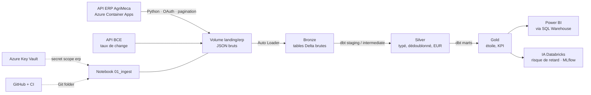

# AgriMeca Supply Chain — Data Engineering sur Azure Databricks

Projet de data engineering de bout en bout : ingestion d'une **API ERP** (OAuth, pagination, quotas, erreurs), architecture **médaillon** sur **Azure Databricks / Unity Catalog**, transformations **dbt**, restitution **Power BI** et un cas d'usage **IA**, pour piloter la performance fournisseurs d'un industriel fictif, AgriMeca.

> Projet personnel d'apprentissage et de portfolio. L'ERP est simulé, mais ses contraintes sont celles d'une vraie API d'entreprise.

---

## Sommaire

1. [Problème métier](#problème-métier)
2. [Architecture](#architecture)
3. [L'API ERP simulée](#lapi-erp-simulée)
4. [Configurations réalisées](#configurations-réalisées)
5. [Ingestion API vers le Volume](#ingestion-api-vers-le-volume)
6. [Travailler en local](#travailler-en-local)
7. [Feuille de route](#feuille-de-route)
8. [Structure du dépôt](#structure-du-dépôt)
9. [Sécurité, qualité et coûts](#sécurité-qualité-et-coûts)
10. [Dépannage](#dépannage)

---

## Problème métier

Les acheteurs d'AgriMeca ne savent pas répondre rapidement à des questions comme :

- Quels fournisseurs livrent **à l'heure et en totalité** (OTIF) ?
- Quels articles concentrent l'essentiel des achats (**analyse ABC**) et dépendent de fournisseurs à risque ?
- Quels sont les **délais réels** de livraison (médiane, P90) par fournisseur ?
- Quelles commandes ouvertes risquent d'arriver **en retard** ?

Les données existent dans l'ERP, mais elles sont exposées par une API et sont « sales » : trois formats de date, devises manquantes, unités hétérogènes (`BOX12`, `KG`), quantités négatives ou multipliées par 1000, doublons de fournisseurs, suppressions logiques.

## Architecture



| Couche | Emplacement Unity Catalog | Outil | Règle |
| --- | --- | --- | --- |
| Dépôt brut | `supplychain.landing.erp` (Volume) | Python (`requests`) | réponse de l'API conservée telle quelle |
| Bronze | `supplychain.bronze.*` | Auto Loader | une ligne par enregistrement, JSON brut + colonnes techniques |
| Silver | `supplychain.silver.*` | dbt | typage, dates, dédoublonnage, conversion EUR, quarantaine |
| Gold | `supplychain.gold.*` | dbt | modèle en étoile, KPI, fiche fournisseur |
| Exploitation | `supplychain.ops.*` | Python / SQL | journal des runs, alertes de volumétrie |

## L'API ERP simulée

API FastAPI déployée sur **Azure Container Apps**, documentée en OpenAPI : `/docs` (Swagger) et `/openapi.json`.

| Route | Rôle |
| --- | --- |
| `POST /auth/token` | jeton OAuth *client credentials*, valable 15 minutes |
| `GET /v1/suppliers` | fournisseurs |
| `GET /v1/parts` | articles |
| `GET /v1/purchase-orders` | commandes d'achat (JSON imbriqué : lignes, fournisseur, site) |

Paramètres de lecture : `limit` (1 000 max), `cursor`, `updated_since`.

Chaque réponse de liste a la même forme :

```json
{
  "data":   [ { "id": "SUP-00001", "name": "…", "audit": { "updated_at": "…" }, "deleted": false } ],
  "paging": { "next_cursor": "eyJ1Ij…", "has_more": true, "limit": 1000 },
  "meta":   { "as_of": "2026-10-31T15:30:00Z", "count": 1000 }
}
```

- **Pagination par curseur** (*keyset*) : le curseur est un JSON encodé en base64 (date de modification, id, `as_of`). On le renvoie tel quel, sans jamais le construire.
- **`meta.as_of`** fige l'instant de lecture et sert de *watermark* pour l'incrémental.
- **Contraintes reproduites volontairement** : 120 appels par minute (`429` + `Retry-After`), environ 5 % d'erreurs `500/503`, jeton expirant, données de qualité variable.

## Configurations réalisées

### 1. Déploiement de l'API sur Azure Container Apps

```bash
az login
az containerapp up -n erp-api -g <resource-group> --location francecentral \
  --environment <container-apps-env> --source . --ingress external --target-port 8000
```

- `az containerapp up` construit l'image à partir du `Dockerfile`, la pousse dans un Azure Container Registry et crée l'application.
- L'URL publique a la forme `https://<app>.<identifiant-environnement>.<région>.azurecontainerapps.io`. Un domaine personnalisé (CNAME + TXT `asuid`) est possible, avec un certificat HTTPS géré gratuitement.
- Le secret client est stocké comme **secret de la Container App** et exposé à l'API par une variable d'environnement (`CLIENT_SECRET` → `secretref:client-secret`). `CLIENT_ID` garde sa valeur par défaut, `agrimeca-data`.

Démarrer ou arrêter l'API pour maîtriser les coûts :

```bash
az extension add --name containerapp --upgrade
az containerapp start -n erp-api -g <resource-group>
az containerapp update -n erp-api -g <resource-group> --min-replicas 0      # mise en veille hors sessions de travail
```

### 2. Azure Key Vault

Deux secrets, lus par Databricks et par les scripts locaux :

| Secret | Contenu |
| --- | --- |
| `erp-base-url` | URL de l'API, sans `/` final |
| `erp-client-secret` | secret OAuth du client `agrimeca-data` |

```bash
az keyvault secret set --vault-name <key-vault> -n erp-base-url      --value "https://…azurecontainerapps.io"
az keyvault secret set --vault-name <key-vault> -n erp-client-secret --value "…"
```

Le secret existe en deux exemplaires (Key Vault pour les consommateurs, secret de la Container App pour l'API). En cas de rotation, il faut mettre à jour les deux, puis redémarrer la révision de la Container App.

### 3. Secret scope Databricks adossé à Key Vault

Créé depuis `https://<workspace>.azuredatabricks.net/#secrets/createScope` :

- *Scope name* : `erp`
- *DNS name* : `https://<key-vault>.vault.azure.net/`
- *Resource ID* : identifiant de ressource du Key Vault

Ce type de scope exige le modèle d'accès *access policy* et un droit de lecture pour l'application Azure Databricks :

```bash
az keyvault update -n <key-vault> --enable-rbac-authorization false
az keyvault set-policy -n <key-vault> --spn 2ff814a6-3304-4ab8-85cb-cd0e6f879c1d --secret-permissions get list
```

Le scope ne stocke rien : c'est un pont vers Key Vault.

```python
BASE_URL = dbutils.secrets.get("erp", "erp-base-url")          # affiché [REDACTED] dans un notebook
dbutils.secrets.list("erp")                                     # vérification
```

### 4. GitHub relié à Databricks

1. Databricks → *Settings* → **Linked accounts** → *Git integration* : GitHub, via l'application Databricks.
2. GitHub → *Configure* : accès en lecture et écriture **à ce seul dépôt**.
3. *Workspace* → *Users* → dossier personnel → **Create → Git folder** avec l'URL du dépôt.

Synchronisation : *Commit & Push* depuis Databricks, `git pull` sur le poste local, et inversement *Pull* dans Databricks après un `git push` local. Les notebooks sont versionnés au format source `.py`, sans leurs résultats.

### 5. Unity Catalog

Un seul catalogue pour tout le projet :

```sql
CREATE SCHEMA IF NOT EXISTS supplychain.landing;
CREATE SCHEMA IF NOT EXISTS supplychain.bronze;
CREATE VOLUME IF NOT EXISTS supplychain.landing.erp;           -- fichiers JSON déposés par l'ingestion
CREATE VOLUME IF NOT EXISTS supplychain.landing.checkpoints;   -- mémoire d'Auto Loader
```

Les schémas `silver` et `gold` sont créés par dbt. Les volumes sont de type *managed* : Databricks gère le stockage.

### 6. Environnement local

```bash
git clone https://github.com/Randriatahina-concept/agrimeca-supplychain-de.git
cd agrimeca-supplychain-de
python3 -m venv .venv && source .venv/bin/activate
pip install -e ".[dev]"            # installe le projet en mode éditable + pytest, responses, ruff
```

`pyproject.toml` décrit le package `erp-ingest` (code dans `src/`) et configure `pytest` et `ruff`. `.gitignore` exclut `.venv/`, `landing/`, `profiles.yml` et `.env`.

## Ingestion API vers le Volume

Arborescence de dépôt, partitionnée à la manière de Hive :

```text
/Volumes/supplychain/landing/erp/
└── suppliers/
    └── ingest_date=20261031/
        └── run_id=20261031T162302Z-1cb007/
            ├── page_000001.json
            ├── page_000002.json
            └── …
```

Chaque fichier contient la réponse brute de l'API plus deux champs de traçabilité :

```json
{ "_run_id": "20261031T162302Z-1cb007", "_fetched_at": "2026-10-31T16:23:03+00:00",
  "data": [ … ], "paging": { … }, "meta": { … } }
```

Logique de la boucle d'ingestion :

| Réponse de l'API | Réaction |
| --- | --- |
| `200` | écrire la page, puis continuer avec `next_cursor` tant que `has_more` est vrai |
| `401` | redemander un jeton, puis refaire le même appel |
| `429` | attendre `Retry-After` secondes, puis refaire le même appel |
| `500` / `503` | attendre, puis refaire le même appel |
| autre erreur | arrêter avec un message explicite (`raise_for_status`) |

Le partitionnement `ingest_date=…/run_id=…` permet de retrouver, recharger ou purger une journée ou une exécution, et Spark le reconnaît comme des colonnes de partition.

## Travailler en local

Le code d'ingestion vit dans un module (`src/erp_ingest/`) sans dépendance à Databricks : il s'exécute gratuitement sur le poste de travail, puis le notebook Databricks l'importe.

```bash
export ERP_BASE_URL=$(az keyvault secret show --vault-name <key-vault> -n erp-base-url --query value -o tsv)
export ERP_CLIENT_SECRET=$(az keyvault secret show --vault-name <key-vault> -n erp-client-secret --query value -o tsv)

python scripts/ingest_local.py     # écrit dans landing/erp/
ruff check src scripts
pytest -q
```

Contrôle rapide des fichiers avec DuckDB, sans Spark :

```bash
python -c "import duckdb; print(duckdb.sql(\"SELECT _run_id, sum(meta.count) FROM read_json('landing/erp/suppliers/*/*/page_*.json') GROUP BY 1\"))"
```

Dans Databricks, le notebook se réduit à :

```python
import os, sys
sys.path.insert(0, os.path.abspath("../src"))
from erp_ingest.simple_ingest import ingest_entity

ingest_entity(
    base_url=dbutils.secrets.get("erp", "erp-base-url").rstrip("/"),
    client_id="agrimeca-data",
    client_secret=dbutils.secrets.get("erp", "erp-client-secret"),
    entity="suppliers",
    landing="/Volumes/supplychain/landing/erp",
)
```

Cycle de travail : coder et tester en local → `git push` → *Pull* dans Databricks → une exécution de validation.

## Feuille de route

La démarche suit une **tranche verticale** : le pipeline complet est d'abord construit pour les fournisseurs, puis étendu aux articles et aux commandes.

| Étape | Contenu |
| --- | --- |
| Module d'ingestion | code réutilisable dans `src/erp_ingest/`, exécutable en local et sur Databricks |
| Bronze avec Auto Loader | `cloudFiles`, checkpoint par table, `trigger(availableNow=True)`, idempotence vérifiée par une double exécution |
| Ingestion robuste | nombre de tentatives limité avec attente croissante, incrémental via `updated_since` et watermark `as_of`, reprise après incident grâce au curseur sauvegardé, journal `ops.ingestion_runs` |
| Tests | `pytest` + `responses` : pagination, renouvellement du jeton, `429`, reprise, incrémental |
| dbt — Silver | sources Bronze, staging (extraction du JSON, typage, dates multi-formats), dédoublonnage des fournisseurs, conversion EUR avec les taux BCE, quarantaine des lignes invalides, historisation SCD2 |
| dbt — Gold | `dim_supplier`, `dim_part`, `fact_po_line` (incrémental `MERGE`), KPI mensuels, fiche fournisseur, délais P50/P90, commandes ouvertes |
| Qualité | tests dbt génériques et spécifiques, documentation et lignage (`dbt docs`) |
| Orchestration | Job Databricks : ingestion → Bronze → `dbt build`, alerte de volumétrie |
| CI | GitHub Actions : `ruff`, `pytest`, `dbt parse` |
| Restitution | Power BI connecté au SQL Warehouse : OTIF, ABC × risque, délais |
| IA | modèle de risque de retard des lignes ouvertes, suivi MLflow, scores réécrits en Gold |
| FinOps | suivi de la consommation via `system.billing.usage` et Azure Cost Management, budget avec alertes |

## Structure du dépôt

```text
agrimeca-supplychain-de/
├── src/erp_ingest/        # code Python d'ingestion (module importable)
├── scripts/               # lancements locaux
├── notebooks/             # notebooks Databricks (format source .py)
├── tests/                 # tests pytest
├── dbt/                   # projet dbt
├── jobs/                  # définition des Jobs Databricks
├── pyproject.toml         # dépendances et configuration (pytest, ruff)
└── .gitignore
```

## Sécurité, qualité et coûts

- **Secrets** : jamais dans le code ni dans Git. Azure Key Vault, secret scope Databricks, variables d'environnement en local.
- **Données** : jamais versionnées (`landing/` exclu), dépôt public sans aucune donnée.
- **Traçabilité** : chaque ligne Bronze porte `_run_id`, `_fetched_at`, `_file` et `_ingest_ts`.
- **Moindre privilège** : l'application Databricks GitHub n'accède qu'à ce dépôt ; Databricks ne peut que lire les secrets du Key Vault.
- **Coûts** :
  - calcul serverless pour les notebooks ;
  - SQL Warehouse 2X-Small avec arrêt automatique à 5 minutes ;
  - API ERP mise en veille hors sessions ;
  - développement en local ;
  - suivi de la consommation :

  ```sql
  SELECT usage_date, billing_origin_product, sku_name, ROUND(SUM(usage_quantity), 2) AS dbu
  FROM system.billing.usage
  WHERE usage_date >= current_date() - INTERVAL 7 DAYS
  GROUP BY ALL ORDER BY usage_date, dbu DESC;
  ```

## Dépannage

| Symptôme | Cause | Solution |
| --- | --- | --- |
| `404` sur toutes les routes de l'API | Container App arrêtée | `az containerapp start …` |
| `401` en cours d'ingestion | jeton expiré (15 min) ou API redémarrée | renouveler le jeton et refaire l'appel |
| `NameError` dans un notebook | session redémarrée, cellules précédentes non réexécutées | *Run all* depuis la première cellule |
| `NameError` sur un paramètre de fonction | lignes hors de la fonction (indentation) | décaler le bloc sous le `def` |
| dossiers `run_id` vides | essais interrompus après la création du dossier | supprimer les runs vides |
| `Could not resolve host: github.com` | résolveur DNS de macOS bloqué | DNS publics (`networksetup -setdnsservers Wi-Fi 1.1.1.1 8.8.8.8`), quitter le VPN |
| `'start' is misspelled` (Azure CLI) | extension `containerapp` trop ancienne | `az extension add --name containerapp --upgrade` |
| catalogue impossible à créer | metastore sans emplacement de stockage par défaut | créer les schémas dans un catalogue existant |

## Stack

Azure Container Apps · Azure Container Registry · Azure Key Vault · Azure Databricks (Unity Catalog, Volumes, Auto Loader, SQL Warehouse, Jobs, MLflow) · Python (`requests`, `pytest`, `ruff`) · dbt · DuckDB · Power BI · GitHub Actions

## Auteur

Charles Randriatahina, Data Engineer
